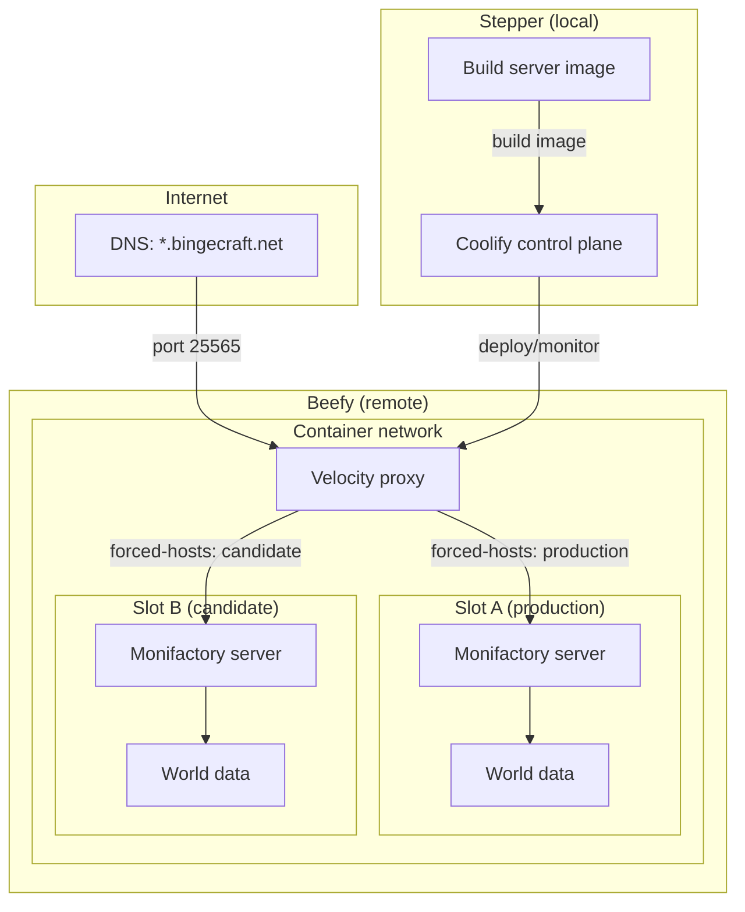

# Mezzanine

## Goal

Run a persistent Monifactory 0.14 Minecraft server on **Beefy**, with **Stepper**
providing the Coolify control plane and deployment automation. Updates should be
repeatable, preserve the world, and have a documented rollback path.

## Target architecture

- **Stepper (local):** Run the self-hosted Coolify control plane and build or
  obtain the server image from the Monifactory source.
- **Beefy (remote):** Run a containerized Velocity proxy and up to two
  Monifactory server containers during updates. Velocity owns the public
  Minecraft port; backend servers use private addresses/ports on a shared
  container network. Give each server slot its own world-data directory; never
  mount one writable world into both.
- **Coolify-to-Beefy connection:** Register Beefy as a managed server in the
  Coolify instance on Stepper. Prepare Beefy for Coolify's supported remote
  deployment method (for example, Docker and SSH); do not assume a second
  Coolify control plane is needed there.
- **Player traffic:** Public DNS names point to Beefy's Velocity listener.
  DNS resolves names to the proxy; Velocity's `forced-hosts` configuration
  maps the hostname in the Minecraft connection to a named backend. The
  candidate can be exposed under a separate test hostname while the production
  hostname remains on the active server. DNS does not point players directly
  at game containers, and changing a Velocity route does not migrate existing
  player sessions or world data.
- **Update routes:** The production hostname (primary route) and candidate
  hostname (secondary route) are configured independently. Deploying a new
  container makes it available at the secondary route only; it never
  implicitly changes the primary route. A separate, explicitly invoked
  promotion operation changes the primary route after validation.
- **Deployment boundary:** Coolify's application rolling update is not the
  server cutover mechanism. Keep Velocity and both backend slots on a network
  where the proxy can reach them, expose only Velocity publicly, and
  coordinate backup, world refresh, route change, and player reconnection as
  one controlled operation. Verify whether the chosen Coolify resource type
  supports the required network and TCP-port configuration; do not assume a
  Compose deployment gets Coolify's application rolling-update behavior.

## Implementation steps

1. [Confirm prerequisites and constraints](stories/01-prerequisites.md)
2. [Prepare the source and image](stories/02-source-and-image.md)
3. [Install and configure Coolify on Stepper](stories/03-coolify-on-stepper.md)
4. [Build and deploy Velocity and the game server](stories/04-velocity-and-server.md)
5. [Make updates and recovery safe](stories/05-updates-and-recovery.md)
6. [Operate the service](stories/06-operate-the-service.md)

## Completion criteria

- Coolify on Stepper can deploy to Beefy without a second control plane.
- The server starts from the reproducible image and is reachable on the
  intended hostname and Minecraft port through Velocity; backend ports are not
  publicly reachable.
- An update can run in a second slot, initialize from a verified backup, and
  become available through a secondary Velocity hostname without changing the
  primary route; production remains on the old server during validation.
- The migration-pending warning is verified for players connecting to the old
  route both before the candidate is ready and while promotion is underway.
- The separately invoked promotion creates a fresh backup of the old world,
  restores it into the candidate, then remaps the primary route only after the
  candidate is verified.
- Players reaching the old backend while migration is pending receive the
  progress/reconnect notice; the old container remains available for rollback
  through promotion.
- The Velocity route change/restart, backup restore, and rollback behavior
  have been tested, including failure before and after promotion.

## References

- [Monifactory](https://github.com/omicron-industries/monifactory) `~/code/omicron-industries/monifactory`
- [Coolify](https://github.com/coollabsio/coolify) `~/code/coollabsio/coolify`
- [Coolify Docs](https://github.com/coollabsio/coolify-docs) `~/code/coollabsio/coolify-docs`
- [Velocity](https://github.com/PaperMC/Velocity) `~/code/papermc/velocity`
- [Monifactory Containerization](https://github.com/bingecraft-net/superfluous) `~/code/bingecraft-net/superfluous`
- [Velocity Containerization](https://github.com/bingecraft-net/velocity) `~/code/bingecraft-net/velocity`

### Prior art to verify against current releases

- The [Superfluous Containerfile](../superfluous/Containerfile) builds the
  dedicated server from a pinned Monifactory refspec, and its
  [build command](../superfluous/commands/build) tags the image. Its
  [backup command](../superfluous/bin/backup) uses RCON save controls before
  archiving world data, while its [startup command](../superfluous/bin/start)
  restores a backup when no world exists. Reuse these patterns only after
  reviewing their assumptions and improving failure handling and backup
  selection for this deployment. This is prior art, not a guarantee that its
  base image, Java version, or scripts are appropriate for 0.14.
- Monifactory's [dedicated server instructions](https://github.com/Omicron-Industries/Monifactory#dedicated-server-installation)
  and [server update FAQ](https://github.com/Omicron-Industries/Monifactory/blob/main/FAQ.md#servers)
  describe the release package and files to replace. Follow the exact target
  release's instructions.
- Coolify's [rolling update guide](https://github.com/coollabsio/coolify-docs/blob/main/content/docs/applications/deployments/rolling-updates.mdx)
  documents when container overlap is unavailable; its
  [rollback guide](https://github.com/coollabsio/coolify-docs/blob/main/content/docs/applications/deployments/rollbacks.mdx)
  makes clear that rolling an image back does not restore persistent world
  data.
- The [Velocity Containerfile](../velocity/Containerfile) builds from pinned
  version/build inputs and bundles the Ambassador plugin. Its
  [velocity.toml](../velocity/overrides/velocity.toml) maps hostnames in
  `forced-hosts` to named server entries and uses modern player-info
  forwarding with a mounted secret. Its [run command](../velocity/commands/run)
  publishes the proxy listener. Adapt these patterns, but replace its
  Podman-specific host addressing and verify plugin purpose, versions,
  configuration reload behavior, and Forge forwarding compatibility for this
  deployment.
