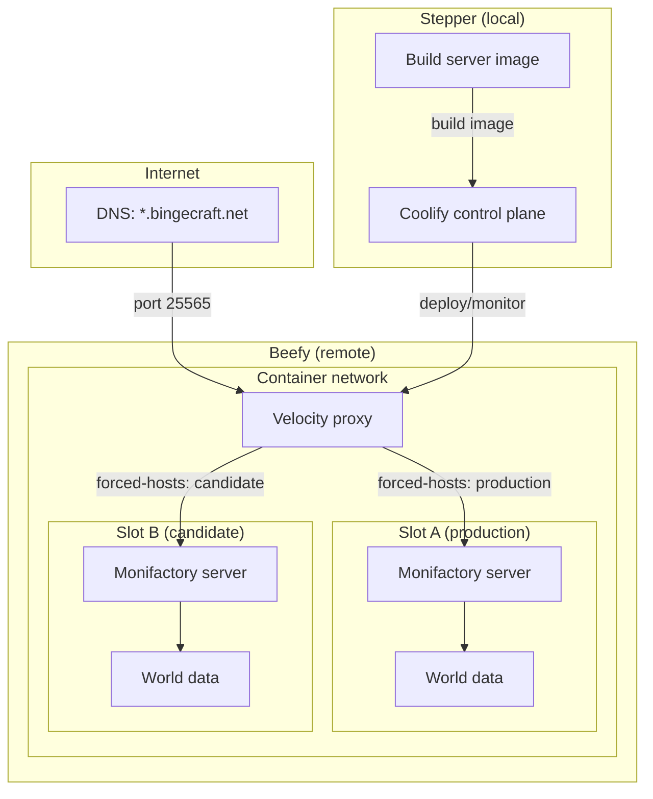

# Mezzanine

## Goal

Run a persistent Monifactory 0.14 Minecraft server on **Beefy**, with **Stepper**
providing the Coolify control plane and deployment automation. Updates should be
repeatable, preserve the world, and have a documented rollback path.

## Target architecture

- **Stepper (local):** Run the self-hosted Coolify control plane and build or
  obtain the server image from the Monifactory source.
- **Beefy (remote):** Run a containerized Velocity proxy and up to two
  Monifactory server containers during updates. Velocity owns the public
  Minecraft port; backend servers use private addresses/ports on a shared
  container network. Give each server slot its own world-data directory; never
  mount one writable world into both.
- **Coolify-to-Beefy connection:** Register Beefy as a managed server in the
  Coolify instance on Stepper. Prepare Beefy for Coolify's supported remote
  deployment method (for example, Docker and SSH); do not assume a second
  Coolify control plane is needed there.
- **Player traffic:** Public DNS names point to Beefy's Velocity listener.
  DNS resolves names to the proxy; Velocity's `forced-hosts` configuration
  maps the hostname in the Minecraft connection to a named backend. The
  candidate can be exposed under a separate test hostname while the production
  hostname remains on the active server. DNS does not point players directly
  at game containers, and changing a Velocity route does not migrate existing
  player sessions or world data.
- **Update routes:** The production hostname (primary route) and candidate
  hostname (secondary route) are configured independently. Deploying a new
  container makes it available at the secondary route only; it never
  implicitly changes the primary route. A separate, explicitly invoked
  promotion operation changes the primary route after validation.
- **Deployment boundary:** Coolify's application rolling update is not the
  server cutover mechanism. Keep Velocity and both backend slots on a network
  where the proxy can reach them, expose only Velocity publicly, and
  coordinate backup, world refresh, route change, and player reconnection as
  one controlled operation. Verify whether the chosen Coolify resource type
  supports the required network and TCP-port configuration; do not assume a
  Compose deployment gets Coolify's application rolling-update behavior.

## Implementation steps

1. **Confirm prerequisites and constraints**
   - Verify Monifactory 0.14's server startup instructions, required Java
     version, ports, memory guidance, and license/EULA requirements.
   - Check Stepper and Beefy's operating systems, available CPU/RAM/disk,
     network reachability, DNS, and firewall rules.
   - Decide where the public DNS names resolve, where Velocity listens, and
     whether the server is private or publicly reachable. Allow public inbound
     Minecraft traffic only to Velocity; keep backend and RCON ports private.
   - Confirm how the selected Coolify deployment resource will attach the
     proxy and game containers to Beefy's private container network.

2. **Prepare the source and image**
   - Follow the dedicated-server instructions for the exact Monifactory
     release: download its server package, install the matching Forge version,
     and apply the release's required setup steps.
   - Build from a pinned release/tag or commit, and tag the resulting image
     with that version (and preferably its source commit); do not build a
     moving branch tip for a production update.
   - Create a reproducible container build using the Java runtime supported by
     that release. Keep mutable server data out of the image; document image
     inputs and version/tag conventions.
   - Build and smoke-test the image before configuring deployment. Keep the
     build separate from the decision to deploy it.

3. **Install and configure Coolify on Stepper**
   - Install Coolify using its current official instructions.
   - Secure access to the control plane and configure its required persistent
     storage and backups.
   - Add Beefy as a remote server and verify Coolify can deploy a harmless test
     workload there.

4. **Build and deploy Velocity and the game server**
   - Build Velocity from pinned version/build inputs, following the prior-art
     container pattern, and keep its configuration and forwarding secret out
     of the image. Store secrets outside Git and inject them securely at
     runtime.
   - Configure Velocity's public listener, online-mode/authentication,
     forwarding mode, protected forwarding secret, named backend entries,
     hostname routes, and fallback behavior. Verify the backend modpack
     supports the selected Velocity forwarding mode; Monifactory's Forge
     server may require a compatible forwarding mod.
   - Run Velocity and both backend slots on a private shared container
     network. Publish the Minecraft port only from Velocity; do not publish
     backend ports or expose RCON publicly. Use container DNS/network aliases
     or another stable internal addressing scheme, not the Podman-specific
     `host.containers.internal` address from the prior-art configuration.
   - Configure the image/build source, resource limits, and environment for
     the game server in Coolify or the chosen declarative deployment
     definition. Mount persistent storage for each slot's world and any
     required server configuration or mod data.
   - Accept the Minecraft EULA only after reviewing its terms.
   - Point a test DNS name at Velocity and route it to the initial backend.
     Verify startup logs, player identity/IP forwarding, modded client
     connectivity, hostname routing, and that direct backend access is
     blocked.

5. **Make updates and recovery safe**
   - When an upstream stable release is available, pin its source, build and
     tag the image, and review the release notes. Treat bleeding-edge builds as
     opt-in, not as stable updates. Once the build is available, decide whether
     to deploy it; a successful build must not automatically make it live.
   - Before deployment, check that Beefy has an open slot for the second
     container, including the resources needed to run it. If no slot is
     available, leave the current server running and defer deployment until a
     slot is available or capacity is deliberately freed.
   - With a slot available, request a consistent backup through the running
     server's RCON (for example, disable saves, issue `save-all`, archive the
     world after writes have flushed, then re-enable saves). Protect RCON
     credentials, verify the command and archive succeeded, and ensure saves
     are re-enabled even when backup creation fails.
   - Store each backup as a uniquely named, versioned artifact. Verify its
     contents and checksum, and keep it outside either replaceable container.
     Restore a specifically selected backup only into the new slot's empty
     world directory; do not implicitly restore whichever archive happens to
     be newest.
   - Add the candidate as a distinct Velocity backend and route a dedicated
     secondary/test hostname to it. Deploying the candidate must not modify
     the primary hostname's route. Validate logs, world loading, and modded
     client access through the secondary route while production remains on the
     old instance. Treat candidate-world changes made during testing as
     disposable; promotion refreshes it from a new backup of the old world.
   - When an update is pending, mark the old route as migration-pending. Use a
     tested Velocity plugin or backend mechanism to notify every player who
     connects to the old container that progress on that connection may not be
     retained and they should reconnect after the update is announced complete.
     Verify this notice works both while the candidate is still starting and
     after it is available but before primary-route promotion. Do not silently
     imply that the old route is the place to continue making durable progress.
   - Promotion is a separate, explicit operator action, invoked only after
     validation via the secondary route. It must not be coupled to or
     automatically triggered by the image build, container deployment, or
     candidate health check.
   - On promotion, enable a migration gate so new connections to the old
     backend receive the progress/reconnect warning and cannot mistake it for
     the durable destination. Prevent new logins to the old world, then take
     and verify a fresh, consistent backup of its world; do not use the
     earlier candidate-test backup. Immediately after the snapshot, notify
     players still connected to the old backend that subsequent progress will
     not be retained, then gracefully disconnect or quiesce them. This makes
     the backup the authoritative cutover point.
   - Restore that fresh backup into the candidate's separate world directory,
     restart/reload the candidate as required, and verify it is healthy and
     serving the restored world. Only then change the primary hostname's
     Velocity route to the candidate. Keep maintenance in place until the
     primary route is verified, then announce completion and have players
     reconnect. Test whether route changes require a controlled Velocity
     reload/restart; do not assume configuration hot-reload or that existing
     sessions move when the route changes.
   - If backup, restore, candidate readiness, or route remapping fails, keep
     the old world and image intact, route the primary hostname to the old
     backend, and reopen it only after confirming the old world is safe to
     resume. A route change alone is not a data rollback.
   - Keep the old image, its separate world data, and the verified backup
     available through the rollback window. If players have already written
     to the new world, do not blindly roll back to the old world; preserve
     both and decide how to reconcile progress.
   - Update the pack's server files from the new release package according to
     Monifactory's server-update guidance (including its config, default
     config, KubeJS, and mods directories). Do not treat the old container's
     entire server directory as persistent state or overwrite the world with
     files from the image.

6. **Operate the service**
   - Set up log access, disk-space monitoring, and alerts for failed deploys or
     unexpected server exits.
   - Schedule and verify backups; periodically test restoring one.
   - Document routine maintenance, update cadence, and recovery steps.

## Completion criteria

- Coolify on Stepper can deploy to Beefy without a second control plane.
- The server starts from the reproducible image and is reachable on the
  intended hostname and Minecraft port through Velocity; backend ports are not
  publicly reachable.
- An update can run in a second slot, initialize from a verified backup, and
  become available through a secondary Velocity hostname without changing the
  primary route; production remains on the old server during validation.
- The migration-pending warning is verified for players connecting to the old
  route both before the candidate is ready and while promotion is underway.
- The separately invoked promotion creates a fresh backup of the old world,
  restores it into the candidate, then remaps the primary route only after the
  candidate is verified.
- Players reaching the old backend while migration is pending receive the
  progress/reconnect notice; the old container remains available for rollback
  through promotion.
- The Velocity route change/restart, backup restore, and rollback behavior
  have been tested, including failure before and after promotion.

## References

- [Monifactory](https://github.com/omicron-industries/monifactory) `~/code/omicron-industries/monifactory`
- [Coolify](https://github.com/coollabsio/coolify) `~/code/coollabsio/coolify`
- [Coolify Docs](https://github.com/coollabsio/coolify-docs) `~/code/coollabsio/coolify-docs`
- [Velocity](https://github.com/PaperMC/Velocity) `~/code/papermc/velocity`
- [Monifactory Containerization](https://github.com/bingecraft-net/superfluous) `~/code/bingecraft-net/superfluous`
- [Velocity Containerization](https://github.com/bingecraft-net/velocity) `~/code/bingecraft-net/velocity`

### Prior art to verify against current releases

- The [Superfluous Containerfile](../superfluous/Containerfile) builds the
  dedicated server from a pinned Monifactory refspec, and its
  [build command](../superfluous/commands/build) tags the image. Its
  [backup command](../superfluous/bin/backup) uses RCON save controls before
  archiving world data, while its [startup command](../superfluous/bin/start)
  restores a backup when no world exists. Reuse these patterns only after
  reviewing their assumptions and improving failure handling and backup
  selection for this deployment. This is prior art, not a guarantee that its
  base image, Java version, or scripts are appropriate for 0.14.
- Monifactory's [dedicated server instructions](https://github.com/Omicron-Industries/Monifactory#dedicated-server-installation)
  and [server update FAQ](https://github.com/Omicron-Industries/Monifactory/blob/main/FAQ.md#servers)
  describe the release package and files to replace. Follow the exact target
  release's instructions.
- Coolify's [rolling update guide](https://github.com/coollabsio/coolify-docs/blob/main/content/docs/applications/deployments/rolling-updates.mdx)
  documents when container overlap is unavailable; its
  [rollback guide](https://github.com/coollabsio/coolify-docs/blob/main/content/docs/applications/deployments/rollbacks.mdx)
  makes clear that rolling an image back does not restore persistent world
  data.
- The [Velocity Containerfile](../velocity/Containerfile) builds from pinned
  version/build inputs and bundles the Ambassador plugin. Its
  [velocity.toml](../velocity/overrides/velocity.toml) maps hostnames in
  `forced-hosts` to named server entries and uses modern player-info
  forwarding with a mounted secret. Its [run command](../velocity/commands/run)
  publishes the proxy listener. Adapt these patterns, but replace its
  Podman-specific host addressing and verify plugin purpose, versions,
  configuration reload behavior, and Forge forwarding compatibility for this
  deployment.
